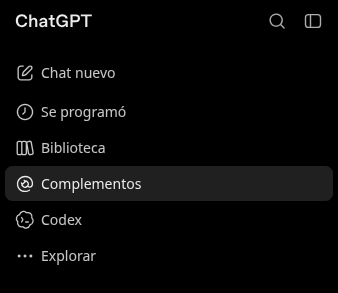
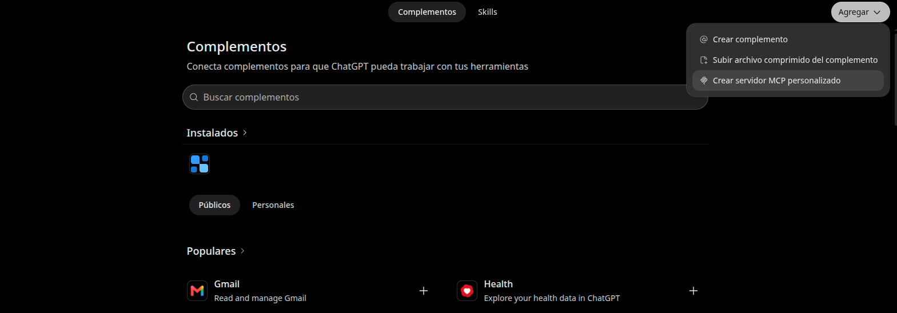
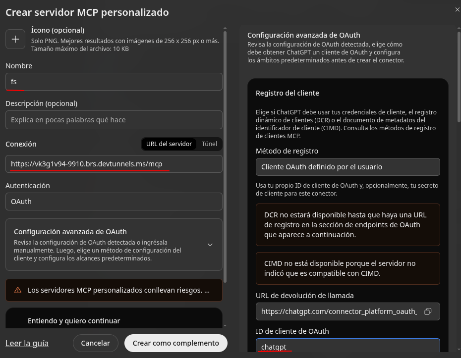
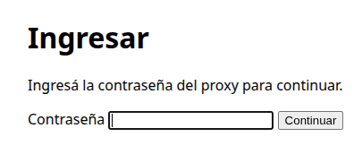

# Harness
Exponer herramientas para un llm como grok o chatgpt.  
Se usa devtunnels de microsoft para obtener un dominio publico

## Llamaharness
Expone las herramientas en para el llm. Para seleccionar una carpeta, ir a la carpeta y correr `llamaharness --host 127.0.0.1`

## OauthProxy
Expone el metodo de autorizacion

## Connector
Genera el tunel y expone oauthproxy 

## Install
```
# install llamaharness
cd llamaharness
npm install
npm link
```

El binario queda en el `PATH` (`which llamaharness`) y funciona en
cualquier carpeta. El servidor expone las
herramientas en la carpeta desde donde se lo inicia.

```
# actualizar tras cada cambio
cd llamaharness
npm link

# desinstalar
npm unlink -g llamaharness
```

```
# install connector
cd connector
npm i
npm build
npm start
```

### En chatgpt



Agregar conector



Agregar servidor mcp



poner dominio y id de cliente:

* `chatgpt`: Para chat
* `grok`: Para grok



Ingrasar la contraseña. En la app(connector) indica la misma:  
Ej:  
**Contraseña de login**: F3dfwwef32423gwsEDESG2tSDAwr23fsdf

### Carpeta a elegir

Ir a una carpeta y correr
```
llamaharness --host 127.0.0.1
```

Esta carpeta es donde trabajara el agente

### Leer imágenes

`llamaharness` expone `read_image` para que el agente inspeccione imágenes locales:

```json
{ "name": "read_image", "arguments": { "path": "docs/image.png" } }
```

Acepta rutas absolutas o relativas a la carpeta donde se inició el servidor,
formatos PNG, JPEG, GIF y WebP, y archivos de hasta 10 MiB. Detecta el MIME por
la firma del archivo y devuelve un bloque MCP `image` con los bytes en base64,
junto con la ruta y el tamaño. El cliente y el modelo deben admitir contenido
de imagen de herramientas MCP. `read_file` sigue siendo para archivos de texto.

Después de actualizar, ejecutá `npm run build` en `llamaharness` y reiniciá el servidor
para que aparezca la nueva herramienta.


